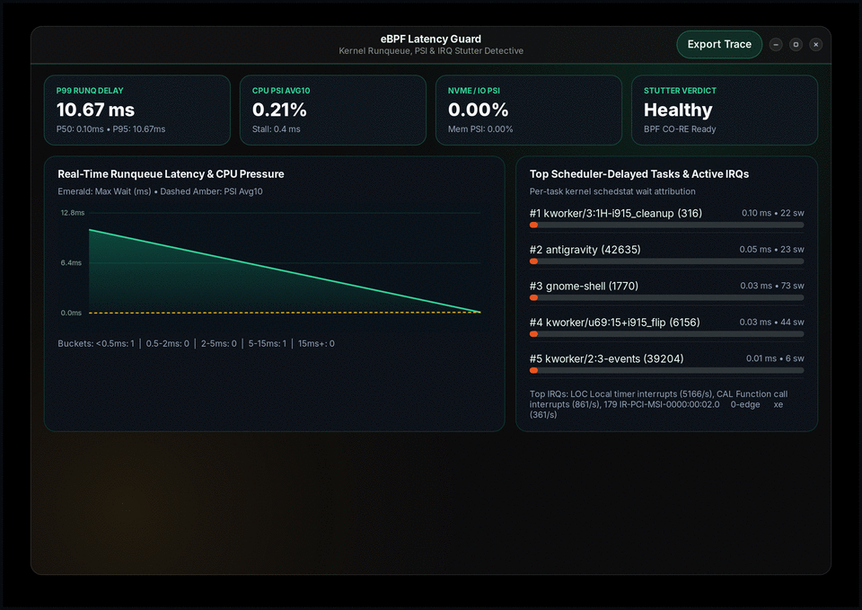

# ebpf-latency-guard

Linux scheduling latency and stall monitor built with an unprivileged C procfs probe, a compiled eBPF tracepoint object (`sched_wakeup`/`sched_switch`), and a GTK4 UI.

<p align="center">
  
</p>

## How it works

- **`elg-probe` (`src/native/latency_probe.c`):** Runs without root privileges, sampling `/proc/pressure/{cpu,io,memory}` (PSI), `/proc/[pid]/schedstat` runqueue wait deltas, and `/proc/interrupts` deltas over `--sample-ms`.
- **`bpf/sched_latency.bpf.c`:** Tracepoint eBPF program (`tracepoint/sched/sched_wakeup` and `sched_switch`) tracking per-PID wakeup-to-schedule latency in log2 microsecond buckets (`sched_hist_map`). Compiled to `bpf/sched_latency.bpf.o` via `clang -target bpf`.
- **`src/elg/`:** Classifies latency verdicts (`HEALTHY`, `CPU_RUNQ_CONTENTION`, `NVME_IO_STALL`, `MEMORY_RECLAIM_STALL`, `IRQ_STORM`) and renders the GTK4/Cairo UI.

<details>
<summary>Static UI screenshot (overview.png)</summary>


</details>

## Build & Run

```bash
make all
make test
./elg-probe --sample-ms 120 --json
PYTHONPATH=src /usr/bin/python3 -m elg.gui
```

## Related

[ff-power-manager](https://github.com/lwrlock/ff-power-manager) · [vram-atlas](https://github.com/lwrlock/vram-atlas) · [waylens-privacy](https://github.com/lwrlock/waylens-privacy) · [mempulse](https://github.com/lwrlock/mempulse) · [netpulse-bpf](https://github.com/lwrlock/netpulse-bpf) · [nvme-sentinel](https://github.com/lwrlock/nvme-sentinel)

## License & Development

MIT — see [LICENSE](LICENSE). Built by Furkan (`@lwrlock`) with AI coding assistance (Google DeepMind Antigravity) and verified on bare-metal Linux hardware.
