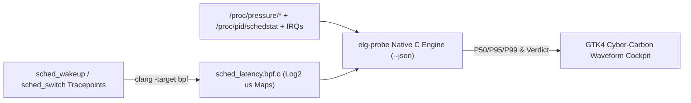
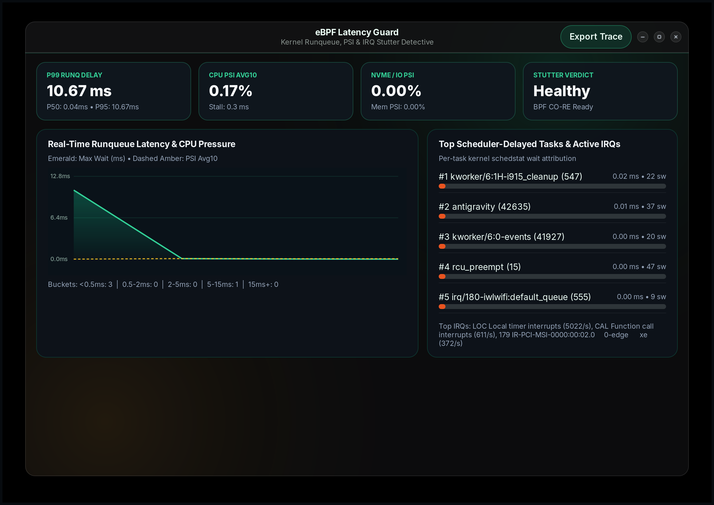

# eBPF Latency Guard

[](LICENSE)
[](#architecture)
[](#gallery)
[](https://github.com/lwrlock/ff-power-manager)

**Real-time Linux micro-stutter & scheduling latency detective pairing an eBPF tracepoint collector (`sched_wakeup`/`sched_switch`) with sub-millisecond `/proc/pressure` (PSI), per-task `schedstat` runqueue wait profiling, IRQ burst delta scanning, and a GTK4 Cyber-Carbon Telemetry HUD.**

<p align="center">
  
</p>

## Architecture



## Why eBPF Latency Guard?

When a Linux desktop or game stutters for 20 ms, `htop` only shows average CPU %. **eBPF Latency Guard** isolates *why* the stall occurred:

| Signal | Kernel Interface | Root-Cause Verdict |
| :--- | :--- | :--- |
| **eBPF Scheduler Tracepoints** | `bpf/sched_latency.bpf.c` | Nanosecond `sched_wakeup` → `sched_switch` delay buckets |
| **PSI Pressure Counters** | `/proc/pressure/{cpu,io,memory}` | `CPU_RUNQ_CONTENTION`, `NVME_IO_STALL`, `MEMORY_RECLAIM_STALL` |
| **Per-Task Runqueue Wait** | `/proc/[pid]/schedstat` | Zero-privilege attribution ranking runqueue-starved tasks |
| **IRQ Burst Radar** | `/proc/interrupts` | Flags `IRQ_STORM` hardware interrupt floods (`nvme`, `iwlwifi`, `xe`) |

<details>
<summary><b>Full-Resolution UI Screenshot</b></summary>

<p align="center">
  
</p>

</details>

## Build & Run

```bash
make all && make test
./elg-probe --json
PYTHONPATH=src /usr/bin/python3 -m elg.gui
```

---

### FF Linux Kernel & Systems Suite
[FF Power Manager](https://github.com/lwrlock/ff-power-manager) · **eBPF Latency Guard** · [VRAM Atlas](https://github.com/lwrlock/vram-atlas) · [Waylens Privacy](https://github.com/lwrlock/waylens-privacy) · [MemPulse](https://github.com/lwrlock/mempulse) · [NetPulse BPF](https://github.com/lwrlock/netpulse-bpf) · [NVMe Sentinel](https://github.com/lwrlock/nvme-sentinel)

MIT License — Copyright (c) 2026 Furkan (**lwrlock**). Built with assistance from Google DeepMind Antigravity.
